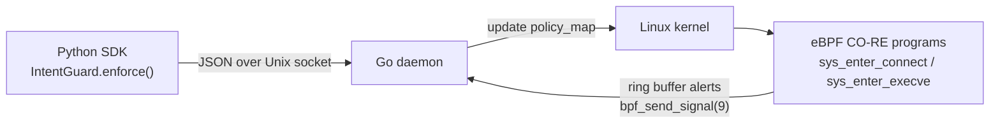

# IntentGuard-eBPF

IntentGuard is a Linux runtime containment system for local LLM agents. A Python
SDK publishes the current agent intent to a Go daemon, which updates an eBPF
policy map. The kernel enforces the policy at `connect(2)` and `execve(2)`
tracepoints and sends a signal plus an alert event when a restricted process
violates its policy.

> **PoC status:** The implementation is validated on a Linux host with kernel
> BTF, LLVM, libbpf, and sufficient eBPF privileges. Benchmark numbers are
> intentionally not included until collected on the target hardware.

## Architecture



## Quick start

Install the build dependencies on Fedora:

```bash
sudo dnf install clang llvm bpftool libbpf-devel golang
```

The host should expose `/sys/kernel/btf/vmlinux`. Build and start the daemon as
the same user that will run the SDK, or run both under the same privileged
account:

```bash
make bpf
make daemon
./intentguardd
```

Secure an agent with three lines:

```python
from intentguard import IntentGuard
with IntentGuard().enforce(block_network=True, block_exec=True):
    agent.run()
```

The policy is removed in a `finally` block when the context exits. The daemon
socket is `/tmp/intentguard.sock` and is created with mode `0600`.

## Tests

Install pytest and run the integration suite while the daemon is running:

```bash
make test
```

The tests cover an allow policy, network blocking, and same-process `execve`
blocking. Tests skip when the daemon socket is unavailable.

## Benchmarks

The benchmark harnesses emit CSV suitable for paper tables and do not claim a
specific latency or memory result. Run them on a dedicated host and record the
kernel, CPU, Go, and Python versions alongside the output.

```bash
python3 benchmarks/benchmark_ipc.py --iterations 1000 --output results/ipc.csv
python3 benchmarks/benchmark_syscall.py --socket /tmp/intentguard.sock --iterations 10000 --output results/syscall.csv
python3 benchmarks/benchmark_resource.py --daemon-pid "$(pgrep -n intentguardd)" --duration 30 --output results/resource.csv
```

The daemon socket is intentionally mode `0600`. If the daemon was started with
`sudo`, run these socket-backed commands with `sudo -E` as well:

```bash
sudo -E python3 benchmarks/benchmark_ipc.py
sudo -E python3 benchmarks/benchmark_syscall.py --socket /tmp/intentguard.sock
sudo -E python3 benchmarks/benchmark_resource.py
```

`benchmark_ipc.py` measures SDK-to-daemon policy round trips. The syscall
benchmark compares localhost requests with and without a daemon policy. The
resource benchmark samples daemon RSS and CPU while sending policy updates.
These commands require a running daemon; the syscall benchmark also requires a
local TCP listener.

## Release workflow

Build the Python wheel with `make sdk`. The package distribution name is
`intentguard-ebpf` while the import remains `intentguard`. Upload a reviewed
wheel using PyPI credentials held outside the repository:

```bash
python3 -m pip install build twine
python3 -m build sdk/python
python3 -m twine upload sdk/python/dist/*
```

The GitHub Actions release workflow builds Linux `amd64` and `arm64` daemon
artifacts from the checked-in CO-RE object and attaches them to a GitHub
release. A release host must generate the object with `make bpf` first.

## Security boundaries

The current PoC keys policies by process ID. Policies do not automatically
propagate to children, and PID reuse must be considered before production use.
The daemon should run with the minimum privileges needed to load and attach the
programs. This project is not a replacement for a VM or a complete
capability-based sandbox.
